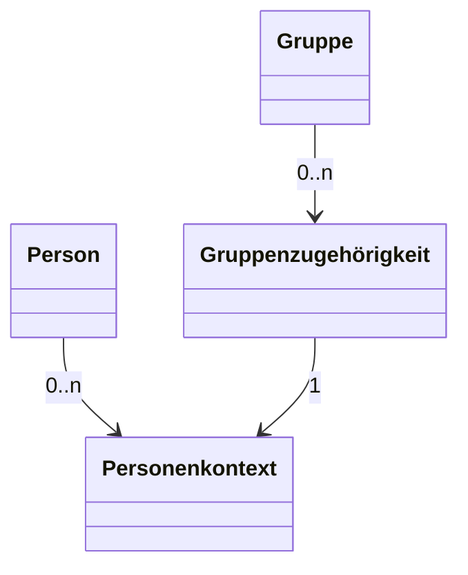

---
tags:
- Verbindlich
---

# Kernanwendungsfälle

Prinzipiell unterstützt die API zwei grundlegend unterschiedliche Anwendungsfälle: Zum
einen die Bereitstellung von Nutzer- und Kontextdaten im Zusammenhang mit einem Single
Sign-on für Anwendungen (Dienste), zum anderen die Synchronisation von Nutzer- und
Kontextdaten zwischen Schulverwaltungssystemen (Quellsystemen).

Ein Schulconnex-Service ist ein Dienst, welcher APIs nach den Vorgaben der Schulconnex-Spezifikation bereitstellt. Der Zugriff auf alle Endpunkte der REST-APIs eines Schulconnex-
Services wird durch einen zentralen Authentifizierungs- und Autorisierungsserver gesichert.
Ein Zugriff auf die Endpunkte darf nur mit einem gültigen, von diesem Server ausgestellten
Access-Token möglich sein. Um Access-Token für die API-Nutzung zu erhalten, müssen
Quellsysteme und Dienste als Clients mit einer Client-ID registriert sein.

## Grundlegende Datenmodelle

Informationen in Schulconnex werden anhand von vier grundlegenden Datenmodellen strukturiert.

Diese Datenmodelle sind Person, Personenkontext, Gruppe und Gruppenzugehörigkeit.

Vereinfacht ist die Beziehung zwischen den Datenmodellen wie folgt:

