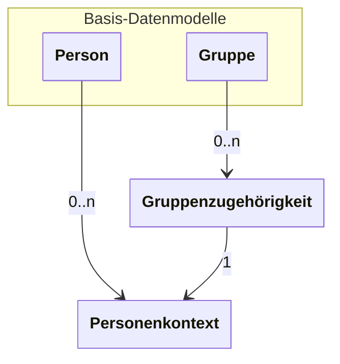

---
tags:
- Verbindlich
---

# Kernanwendungsfälle

Prinzipiell unterstützt die API zwei grundlegend unterschiedliche Anwendungsfälle: Zum
einen die Bereitstellung von Nutzer- und Kontextdaten im Zusammenhang mit einem Single
Sign-on für Anwendungen (Dienste), zum anderen die Synchronisation von Nutzer- und
Kontextdaten zwischen Schulverwaltungssystemen (Quellsystemen).

Ein Schulconnex-Service ist ein Dienst, welcher APIs nach den Vorgaben der Schulconnex-Spezifikation bereitstellt. Der Zugriff auf alle Endpunkte der REST-APIs eines Schulconnex-
Services wird durch einen zentralen Authentifizierungs- und Autorisierungsserver gesichert.
Ein Zugriff auf die Endpunkte darf nur mit einem gültigen, von diesem Server ausgestellten
Access-Token möglich sein. Um Access-Token für die API-Nutzung zu erhalten, müssen
Quellsysteme und Dienste als Clients mit einer Client-ID registriert sein.

## Grundlegende Datenmodelle

Informationen in Schulconnex werden anhand von vier grundlegenden Datenmodellen strukturiert.

Diese Datenmodelle sind `Person`, `Personenkontext`, `Gruppe` und `Gruppenzugehörigkeit`.

Vereinfacht ist die Beziehung zwischen den Datenmodellen wie folgt:

Das Datenmodell `Person` enthält Attribute zu Personen, wie Name oder Geburtsdatum.

Einer `Person` können Personenkontexte zugeordnet werden, welche die Rolle der `Person` in verschiedenen Kontexten beschreiben. So kann eine Person in einer Organisation die Rolle eines Schulbegleiters oder einer Schulbegleiterin haben, während sie in einer anderen Organisation die Rolle eines oder einer Lehrenden hat. Dabei sind einzelne Personenkontexte so spezifisch wie möglich. Hat eine `Person` in einer Organisation mehrende Rollen (wie Organisationsleitung,
SysAdmin und Lehrende), so besteht für jede dieser Rollen ein eigenen `Personenkontext`.

Das Datenmodell `Gruppe` enthält Informationen zu zeitlich begrenzten Aktivitäten, meist Schulfächern. Eine `Gruppe`  enthält Attribute wie Jahrgangsstufen, Bildungsziele. Fächer und eine Laufzeit.

Einer `Gruppe` könnnen Gruppenzugehörigkeiten zugeordnet werden. Diese beschreiben Rollen, die innerhalb der Gruppe auftreten, beispielsweise Klassenleitung, Vertretungslehrkraft oder Lernende, sowie einen Zeitraum für die `Gruppenzugehörigkeit`.

Über die ID eines Personenkontextes wird eine Gruppenzugehörigkeit mit einem Personenkontext verknüpft und erlaubt damit, indirekt, die Zuuordnung einer Person zu einer Gruppe.

## Mandanten und Referrer

Um eine eindeutige Zuordnung von Datensätzen zu der Organisation zu schaffen, welche die datenschutzrechtliche, inhaltliche und systemische Verfügungsgewalt über den Datensatz besitzt, enthalten die grundlegenden Datenmodelle das Attribut `Mandant`. Dieses Attribut enthält die ID der Organisation, welche schreibenden, ändernden oder löschenden Zugriff auf den jeweiligen Datensatz hat. 

Da Anwendungen, welche mit Schulconnex-Servern Daten austauschen, teilweise eigene Identifikatoren für Datensätze nutzen, erlaubt das Attribut `Referrer` die Angabe einer eigenen ID, zusätzlich zu der von Schulconnex vergebenen ID.
