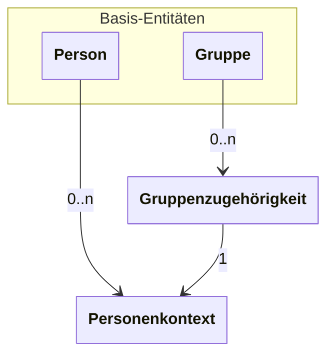

---
tags:
- Verbindlich
---

# Kerndatenmodell

Das Kerndatenmodell von Schulconnex umfasst die vier Datenmodelle `Person`, `Personenkontext`, `Gruppe` und `Gruppenzugehörigkeit`. Die Basis bilden `Person` und `Gruppe`; `Personenkontext` und `Gruppenzugehörigkeit` setzen diese voraus.

Vereinfacht ist die Beziehung zwischen den Datenmodellen wie folgt:

Das Datenmodell `Person` enthält Attribute zu Personen wie Name oder Geburtsdatum.

Einer `Person` können Personenkontexte zugeordnet werden, welche die Rolle der `Person` in verschiedenen Kontexten beschreiben. So kann eine Person in einer Organisation die Rolle eines Schulbegleiters oder einer Schulbegleiterin haben, während sie in einer anderen Organisation die Rolle eines oder einer Lehrenden hat. Dabei sind einzelne Personenkontexte so spezifisch wie möglich. Hat eine `Person` in einer Organisation mehrere Rollen (wie Organisationsleitung oder Lehrende), so besteht für jede dieser Rollen ein eigener `Personenkontext`.

Das Datenmodell `Gruppe` bildet Gruppen von Personenkontexten ab, die zeitlich begrenzt sein können, wie z. B. Schulklassen, Kurse oder Unterrichte. Eine `Gruppe` enthält Attribute wie Jahrgangsstufen, Bildungsziele, Fächer und eine Laufzeit.

Einer `Gruppe` können Gruppenzugehörigkeiten zugeordnet werden. Diese beschreiben Rollen, die Personenkontexte innerhalb der Gruppe haben, beispielsweise Klassenleitung, Vertretungslehrkraft oder Lernende, sowie einen Zeitraum für die `Gruppenzugehörigkeit`.

Über die ID eines Personenkontextes wird eine Gruppenzugehörigkeit mit einem Personenkontext verknüpft und erlaubt damit, indirekt, die Zuordnung einer Person zu einer Gruppe.

## Mandanten und Referrer

Um eine eindeutige Zuordnung von Datensätzen zu dem Mandanten zu schaffen, welcher die datenschutzrechtliche, inhaltliche und systemische Verfügungsgewalt über den Datensatz besitzt, enthalten alle Datenmodelle des Kerndatenmodells das Attribut `mandant`. Dieses Attribut enthält die ID des Mandanten, welcher schreibenden, bearbeitenden oder löschenden Zugriff auf den jeweiligen Datensatz hat.

Da Quellsysteme teilweise eigene Identifikatoren für Datensätze nutzen, erlaubt das Attribut `referrer` die Angabe einer eigenen ID zusätzlich zu der von Schulconnex vergebenen ID.
